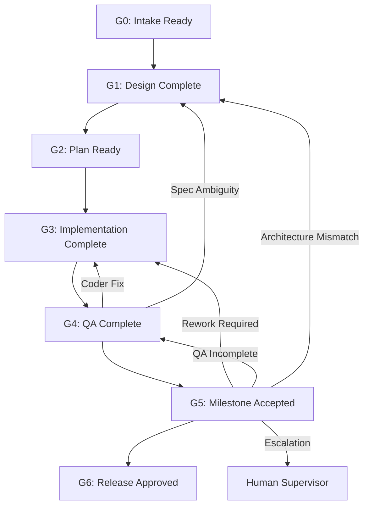

# Operating Phase Gates (G0 - G6)

The multi-agent software engineering team enforces rigorous phase gates adapted from the IEEE SWEBOK v4 process framework and the AI-Assisted Software Engineering Methodology.

---

## Gate Definitions

### G0: Intake Ready
- **Owner:** Architect & Human Requester
- **Entry Condition:** Feature request, bug report, or refactoring task initiated.
- **Exit Condition:** Scope boundaries, problem definition, non-functional requirements, and initial acceptance criteria established.

### G1: Design Complete
- **Owner:** Architect (Online Frontier Model - e.g., Gemini 2.5 Pro)
- **Entry Condition:** G0 exit criteria met.
- **Exit Condition:** `DESIGN.md` created with component diagrams, interface signatures, type definitions, and failure modes documented.

### G2: Plan Ready
- **Owner:** Architect
- **Entry Condition:** G1 design approved.
- **Exit Condition:** `PLAN.md` created with atomic sequenced tasks, file scopes, explicit acceptance criteria mapping, and unit test requirements.

### G3: Implementation Complete
- **Owner:** Coder (Local Model - Ollama Qwen2.5-Coder)
- **Entry Condition:** G2 plan available; `dev` branch active.
- **Exit Condition:** Code changes completed for assigned task; local unit tests passing; `HANDOFF.md` generated with diff and execution output.

### G4: QA Complete
- **Owner:** QA (Independent Fast Model - Gemini 2.5 Flash)
- **Entry Condition:** G3 implementation handoff available.
- **Exit Condition:** Automated test execution verified; independent boundary and negative tests executed; diff inspected; `QA_REPORT.md` filed with formal disposition.

### G5: Milestone Accepted
- **Owner:** Auditor (Independent Frontier Model - Gemini 2.5 Pro)
- **Entry Condition:** G4 QA complete with PASS disposition.
- **Exit Condition:** Holistic integration/E2E validation passing; no architectural drift detected; security and maintainability verified; `AUDITOR_DECISION.md` records ACCEPT.

### G6: Release Approved
- **Owner:** Human Authority / Production Release Process
- **Entry Condition:** G5 Milestone accepted.
- **Exit Condition:** Authorized human reviews audit artifacts and approves final merge to `main` and deployment.
