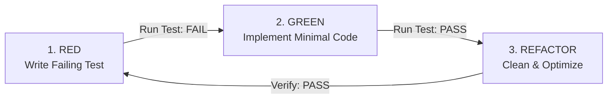

# SWE TDD (Test-Driven Development Workflow)

The **SWE TDD** skill operationalizes the strict **Red -> Green -> Refactor** cycle across the Coder and QA roles. Grounded in SWEBOK v4 (Software Construction & Testing KAs), TDD guarantees that every line of logic is directly tied to an automated test verifying external behavior.

---

## The TDD Operating Loop



### Phase 1: RED (Author Failing Test)
1. Read the task specification from `PLAN.md`.
2. Write a focused test that calls the code exactly the way a real consumer will call it.
3. Assert the expected observable outcome against a literal value.
4. **Execute the test**: Verify that it fails for the *expected* reason (e.g., function not implemented or incorrect result, not syntax error in test).
   ```bash
   pytest tests/unit/test_feature.py
   # MUST FAIL
   ```

### Phase 2: GREEN (Make It Pass)
1. Implement the *minimal* coherent code necessary to satisfy the assertion (per the Laziness Protocol).
2. Avoid adding unrequested features, speculative parameters, or premature optimizations.
3. **Execute the test**: Verify that it now passes cleanly.
   ```bash
   pytest tests/unit/test_feature.py
   # MUST PASS
   ```

### Phase 3: REFACTOR (Improve Structure Safely)
1. Remove duplication, improve variable naming, and tighten types.
2. Ensure no unnecessary comments or intermediate variables remain.
3. **Re-run the test suite**: Confirm tests remain 100% green without regressions.
   ```bash
   pytest tests/
   ```

---

## Anti-Patterns to Avoid

- **Testing Mocks Instead of Behavior**: If a test passes when every imported function returns `None` or `undefined`, the test is asserting mock wiring rather than real software behavior.
- **Testing Private Implementation Details**: Test through public contracts and interfaces defined in `DESIGN.md`. Do not write tests for private helper functions unless isolated in a dedicated internal module.
- **Writing Tests After Code**: Writing tests after the fact almost always introduces confirmation bias where tests merely replicate the bugs present in the implementation.
