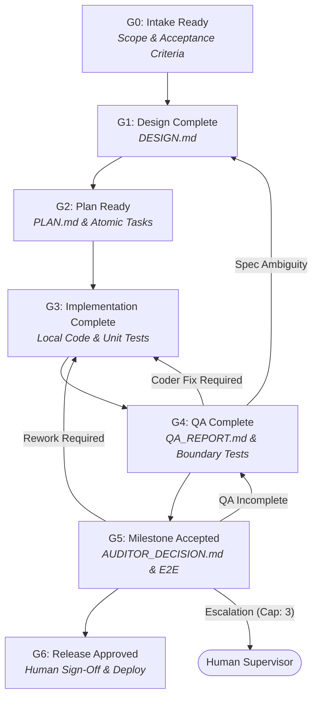

# AI Software Engineering Team: Multi-Model Architecture

An enterprise-grade, multi-agent operating system and skill suite for autonomous, auditable, and cost-effective software engineering. Built on a hybrid architecture combining **frontier online reasoning models** (Google Gemini 2.5 Pro / Flash) with **local open-weight coding models** (Qwen2.5-Coder via Ollama), this platform provides professional rigor while reducing cloud API costs by an estimated 70–90%.

---

## 🏛️ Theoretical & Practical Foundations

This system synthesizes four foundational engineering frameworks and references:

1. **AI-Assisted Software Engineering Methodology**: The 4-agent operating model (Architect, Coder, QA, Auditor), strict separation of duties, 6-phase gating lifecycle (G0–G6), and mandatory evidence before disposition.
2. **Agentic GitOps & Multi-Model Architecture**: Utilizing Git branches and pull requests as the state machine and message bus; offloading 80%+ of code generation to local models to bypass cloud rate limits and protect budgets.
3. **IEEE SWEBOK v4 (Software Engineering Body of Knowledge)**: Structuring agent capabilities across recognized knowledge areas: Software Requirements, Architecture, Design, Construction, Testing, Quality, Security, and Configuration Management.
4. **pstack**: High-rigor engineering playbooks, adversarial multi-model interrogation, boundary discipline, and the 23 core software engineering principles.

---

## 🤖 Role Matrix & Model Assignments

| Role | Assigned Model | Host / Runtime | Primary Focus | SWEBOK KAs |
|---|---|---|---|---|
| **Architect** | **Gemini 2.5 Pro** | Google AI Cloud | Requirements modeling, system architecture, API contracts, `PLAN.md` decomposition | Requirements, Architecture, Design |
| **Coder** | **Qwen2.5-Coder** (14B/32B) | Local Ollama (`:11434`) | Daily construction, boilerplate, localized unit tests, bug fixes | Construction, Maintenance |
| **QA** | **Gemini 2.5 Flash** | Google AI Cloud | Independent test validation, boundary test generation, log triage, diff inspection | Testing, Quality |
| **Auditor** | **Gemini 2.5 Pro** *(Independent Session)* | Google AI Cloud | Milestone gating, architectural drift detection, E2E validation, security audit | Quality, Security, Management |
| **Orchestrator** | **Gemini 2.5 Pro** | IDE Supervisor | G0–G6 lifecycle management, GitOps branching, loop caps, escalation | Engineering Process, SCM |

---

## 🔄 Phase Gates Lifecycle (G0 to G6)



---

## 📂 Skill Suite Structure (`.agents/skills/`)

```text
.agents/
├── rules/
│   └── swe-team-rules.md             # Always-on operating rules and constraints
└── skills/
    ├── swe-orchestrator/              # Master lifecycle coordinator (G0-G6)
    │   ├── SKILL.md
    │   └── references/
    │       ├── phase_gates.md         # Detailed gate entry/exit criteria
    │       ├── principles.md          # 23 core engineering principles
    │       └── templates/
    │           ├── DESIGN_TEMPLATE.md
    │           ├── PLAN_TEMPLATE.md
    │           ├── HANDOFF_TEMPLATE.md
    │           ├── QA_REPORT_TEMPLATE.md
    │           └── AUDITOR_DECISION_TEMPLATE.md
    ├── swe-architect/                 # System design & contract modeling
    │   └── SKILL.md
    ├── swe-coder/                     # Local implementation & construction
    │   └── SKILL.md
    ├── swe-qa/                        # Independent validation & test triage
    │   └── SKILL.md
    ├── swe-auditor/                   # Milestone audit & principal review
    │   └── SKILL.md
    ├── swe-local-bridge/              # Ollama connectivity & context pruner
    │   ├── SKILL.md
    │   └── scripts/
    │       └── ollama_bridge.py
    ├── swe-interrogate/               # Adversarial multi-lens code review
    │   └── SKILL.md
    ├── swe-tdd/                       # Red-Green-Refactor test cycle
    │   └── SKILL.md
    └── swe-blast-radius/              # Change impact and caller analysis
        └── SKILL.md
```

---

## 🚀 Quickstart & Usage

### 1. Configure the Local Coder (Ollama)
Ensure Ollama is installed and running locally:

```bash
# Verify local bridge connectivity
python .agents/skills/swe-local-bridge/scripts/ollama_bridge.py health

# Pull the recommended coding model
ollama pull qwen2.5-coder:14b
# Or for 24GB+ VRAM:
ollama pull qwen2.5-coder:32b
```

### 2. Initiating a Software Engineering Workflow
Invoke the orchestrator directly in chat:
> *"Use `/swe-orchestrator` to build a user authentication microservice with JWT and rate limiting."*

The orchestrator will:
1. Engage **Architect** to produce `DESIGN.md` and `PLAN.md`.
2. Dispatch atomic implementation tasks to the local **Coder** via `ollama_bridge.py`.
3. Hand off the code to independent **QA** for regression and boundary verification.
4. Freeze development at the milestone and invoke **Auditor** for architectural drift inspection.
5. Present the verified evidence package for final human approval.
